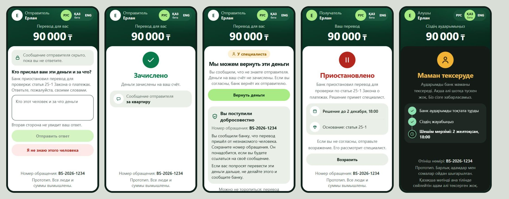
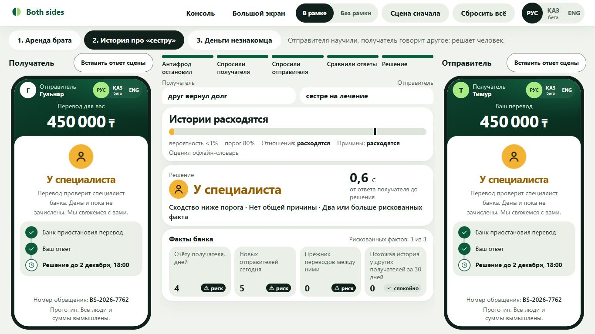
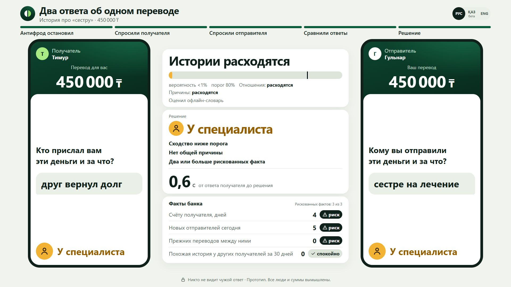
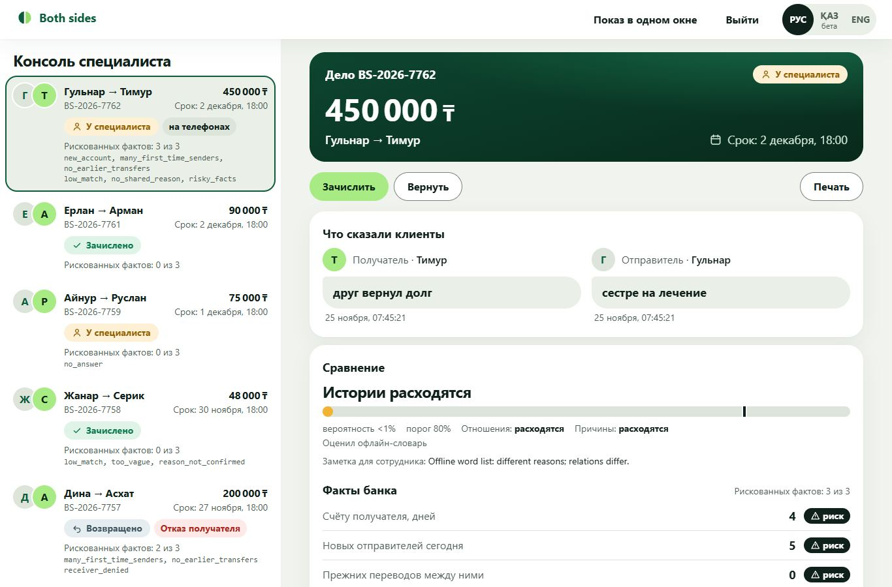

# Both sides

When a bank's anti-fraud stops a transfer between two of its clients, this prototype asks **both** people separately, "who and what for?", and compares the two free-text answers in Kazakh, Russian or a mix.

Why: phone scammers coach the sender before the bank calls. Asking only the sender means hearing the scammer's story. The receiver was not coached by the same call, or is a stranger.

Try it: <https://both-sides-six.vercel.app> (landing page and the whole app)

Hackathon project for the BCC case of ITU HACKATHON-2026. It is a prototype, not a bank app and not an official BCC product. All people and amounts are invented.

## Run

Python 3.11 or newer. No packages are needed for the offline demo, and no Node: the built interface is in `web/`.

```bash
python run.py --offline
```

The terminal prints the addresses and the staff password. Open <http://127.0.0.1:8000/> for the landing page or <http://127.0.0.1:8000/start> for the app.

| Want | Command |
|---|---|
| Offline matcher only | `python run.py --offline` |
| With Gemini | `pip install -r requirements.txt`, set the key (below), `python run.py` |
| Two real phones on a private network | `python run.py --host 0.0.0.0 --port 8000`, then open `http://<laptop address>:8000/receiver` and `/sender` |
| Your own staff password | set `BOTHSIDES_STAFF_PASSWORD` (10 characters or more) before the start |

For demo day set `BOTHSIDES_STAFF_PASSWORD`: without it every start makes a new random password. Show `/demo` and `/stage` in full screen (F11); they are laid out for 1366×768 and up.

### Gemini key

The key is read from the environment variable `GEMINI_API_KEY` only. It stays on the server: it is never sent to the browser, logged or committed.

PowerShell:

```powershell
$env:GEMINI_API_KEY = "your key"; python run.py
```

Command Prompt:

```bat
set GEMINI_API_KEY=your key
python run.py
```

Or copy `.env.example` to `.env` and write the key there (saved as UTF-8; `.env` is in `.gitignore`). Without a key the app runs on the offline matcher and says so on the start page.

Check the connection with ten short live requests:

```bash
python evaluation/live_check.py
```

## Screens

| Address | Who | What |
|---|---|---|
| `/` | everybody | Landing page for the jury: the idea in one scroll, and a mini-demo |
| `/start` | everybody | What the demo shows, links, which matcher is active |
| `/receiver`, `/sender` | the two clients | Phone pages. No score, no reason, never the other answer |
| `/demo` | staff | Both phones and the stage in one window, scene chooser, reset, switch between framed and plain phones |
| `/stage` | staff | Big screen: both phones, match, bank facts, decision, seconds |
| `/console` | staff | Case list and the readable case file, "Release" and "Return" |
| `/login` | staff | Password; locked for five minutes after five wrong tries |

The app: Russian first, Kazakh (beta) and English one tap away. Each screen keeps its own language, so the two phones can differ. The landing page: English first.



| Demo in one window | Stage | Console |
|---|---|---|
|  |  |  |

### Design

One visual language for all screens, made from patterns that Revolut, Nubank, Chime, Wise and Monzo have made familiar: a coloured top with the other person and a large amount, a sheet over it, pill buttons with one bright action colour, grey tiles, feed rows with avatars, a transfer tracker. No names, logos, fonts or images of these banks are used.

Status colours mean the same on every screen: green is credited, amber is with a specialist, red is for holds and denials only. The colours are tokens in [index.css](frontend/src/styles/index.css); the tests check every text and background pair in the light and the dark theme against WCAG AA.

## Landing page (`/`)

One long scroll in English, Russian and Kazakh (beta): the problem, the insight, the six steps, the two outcomes, the mother story, "I do not know this person", a mini-demo, the law, the honest status. It needs no internet: fonts, videos and scripts are in `web/`.


- **Mini-demo.** `POST /api/try` runs the offline matcher and the content rule of the app, the same code and the same test cases ([match_cases.json](tests/shared/match_cases.json)). It never asks a language model, stores nothing, writes no answer to the log, takes at most 300 characters per answer and 30 tries a minute per address.
- **Words.** All in one file, [texts.ts](frontend/landing/src/texts.ts); only the typed example answers stand in [examples.ts](frontend/landing/src/examples.ts), because they are never translated, and `index.html` holds the English title and description for the moment before the script runs. Status words, questions and reasons come from the app's own files. The numbers come from `evaluation/results/offline.json` when the page is built.
- **Pictures.** Made with AI (Google Flow), and the page says so. No logo of the bank, no faces, no real notes. Sources, prompts and cuts: [part2-landing-page.md](docs/part2-landing-page.md).
- **Motion.** One video plays at a time, a button stops all of them, and "reduce motion" of the system shows still pictures only. Phones get their own upright files.
- **Still to fill in:** team name, contact and the place for the logo (`closing.team`, `closing.contact`, `closing.logo` in `texts.ts`), then `npm run build`.

Checked in Edge and Chrome, and in the Firefox and WebKit engines of Playwright on Windows, at emulated sizes. Not checked: real phones, Safari on a real iPhone, a screen reader, a native speaker.

## Online (Vercel)

<https://both-sides-six.vercel.app> carries the landing page and the whole app: phones, stage, console, demo page. The files of `web/` are static; [api/app.py](api/app.py) answers the app's addresses and [api/compare.py](api/compare.py) the mini-demo, so the mini-demo works even when the app does not. No build, no packages, no key: the offline matcher compares. `vercel.json` and `.vercelignore` hold the settings.

Functions on Vercel stop and start as they like and share no memory. So online every visitor has a board of their own: what happened on it travels in signed cookies, and any running copy plays it again ([online.py](bothsides/server/online.py)). It differs from the laptop in three points:

- staff pages are open without a password, because a visitor sees only the own board with invented people;
- one board per browser: two real phones cannot share a case (use the laptop for that);
- a board starts again after two hours without an action, and after a new deployment.

After a change run `npm run build` in `frontend/`, then from this folder:

```bash
npx vercel link --project both-sides
npx vercel deploy --prod
```

The page asks search engines not to list it.

## Demo in 60 seconds (`/demo`)

| Time | Do | Say |
|---|---|---|
| 0:00 | Scene 1 is open | "Anti-fraud stopped a transfer. We ask both people, and neither sees the other answer." |
| 0:05 | Left: insert the scene's answer, send. Right: the same | "One writes Kazakh, one Russian. Same transfer. Credited in seconds." |
| 0:20 | Scene 2. Left: insert, send. Right: insert, send | "The sender was told to say: to my sister, for treatment. The account owner says: a friend returned a debt. A person checks it." (With Gemini: held.) |
| 0:40 | Scene 3. Tap "I do not know this person" twice | "A stranger's money: the bank offers a return and a good-faith notice with a case number." |
| 0:52 | Open the console | "The specialist gets a ready case file with the law, both answers and the deadline." |

Every scene can be run again with "Restart scene"; "Reset all" gives a clean board.

## Decision rules

The thresholds are in [bothsides/config.py](bothsides/config.py), the gate is [bothsides/decision/gate.py](bothsides/decision/gate.py). The word lists, the weights and the limits of the offline matcher (three reasons, weak reasons) are in [bothsides/data](bothsides/data).

**Released at once** only when all of these hold:

- match probability at least 0.80
- each answer has at least two informative words ("ok", "money", "debt", "thanks", "мой" … carry no content; keyboard runs such as "asdf" neither; common forms of one word count once)
- Gemini scored it: it also said `same_reason: true`
- the offline matcher scored it: both answers share a reason of its word list; "half" or "a purchase" alone counts only if not both sides name something different of their own; an answer that lists more than three reasons shares none; neither does an answer with a negation ("не", "нет", "емес", "not", common denying forms of Kazakh verbs), because a word list cannot tell what is denied
- at most one risky bank fact (account younger than 14 days; three or more first-time senders today; no earlier transfers between the two)
- fewer than two other receivers got a similar sender story in the last 30 days

**Held** only when Gemini scored it, the probability is below 0.35, both answers have content and Gemini did not answer `unknown` about the reason. The offline matcher never holds.

**Everything else goes to a person**: the typed denials and coached phrases listed in [denials.json](bothsides/data/denials.json), no answer within 24 hours, no matcher, vague answers, two or more risky facts.

After "I do not know this person" the sender is asked as usual. The answer goes into the case file and is not compared; the sender's phone looks the same as in any other review.

Only a person ends a hold. The deadline is 18:00 on the fifth working day, counted from the day after the stop; weekends and the public holidays in the config are skipped.

## The AI part

- Gemini through the Interactions API of `google-genai` with structured output, `store=False`, one attempt, 20 seconds in total. The call was written from the documentation page on structured outputs and the source of version 3.6.1 on 24 November 2026.
- Sent: both answers, after digits, amounts, currency words, contacts and one leading name followed by a comma are removed. A name is removed only if it is in [names.json](bothsides/data/names.json); relation words like "Брат," or "Жене," stay. Never sent: account data, amounts, the transfer message.
- The answers travel as JSON data with the instruction to ignore any instruction inside them. The reply is validated field by field.
- On timeout, error, invalid JSON or a missing key the offline matcher answers. If nothing answers, a person decides.
- The model must be on Google's list; otherwise the newest listed Flash model is used, and the start page says so. If the list cannot be read at the start, it is asked again after the next comparison.

The offline matcher uses the standard library only: word stems, a Kazakh-Russian-English word list, character trigrams, a fuzzy ratio and relation agreement, combined by a logistic function with fixed weights.

## Measured so far

Offline matcher on 99 simulated pairs, calm bank facts. The pairs were written by language models that could not see the matcher. No real customers were involved.

| Measured on simulated pairs | Result |
|---|---|
| Honest pairs released at once | 19 of 40 |
| Strangers who know only first name and amount, released | 2 of 20 |
| Answers about another transfer, released | 2 of 21 |
| Both told the story in one line, released | 10 of 18 |
| AUC honest against strangers | 0.92 |
| AUC honest against another transfer | 0.86 |
| AUC honest against both told the story | 0.43 |
| AUC honest against all others | 0.75 |

The pairs are few, so the intervals are wide: 95% for the honest pairs is 33% to 63%. `python evaluation/evaluate.py` prints all of them.

The table shows the last run. The first one gave 20 of 40, 4 of 20, 2 of 21 and 11 of 18. In between, reviewers and checkers corrected the word lists, and the rule about negations was added. They did not see the pairs, and nothing was tuned on them.

**Gemini: not measured yet.** Run it with your key:

```bash
python evaluation/evaluate.py --gemini
```

## What is mocked

Accounts, clients, amounts, the bank facts, the anti-fraud flag that stops the transfer, the push message to the phones and the bank's own process around a case. Four closed or waiting cases in the console are seeded examples; two of them carry a score that was set in advance. Customers have no login in the demo. Nothing is stored: a restart is a clean board.

## Known limits

- **The weak point.** If a gang coaches both people with the same story, the comparison alone lets them through (10 of 18 in the table above). Bank facts, the repeated-story check and a person must stay in the loop.
- The offline matcher reads words, not sentences. The same listed reason on both sides can pass even with a wrong relation or a common cover story.
- The lists of typed denials and coached phrases know common wordings in three languages, not every paraphrase. An unlisted one without a negation is credited by the offline matcher when both sides also name the same reason. The button "I do not know this person" does not depend on words.
- The other way round, an honest answer with a negation ("никто не просил, сам подарил") goes to a person with the offline matcher.
- Amounts are removed before Gemini is asked, also in words; a rare wording may stay in the text.
- About half of the honest pairs go to a person with the offline matcher. That is on purpose: it releases only what it can name.
- It covers transfers inside one bank only, because it asks only the bank's own clients.
- Law on Payments, article 25-1, paragraph 3-1, sub-paragraph 2 says that the bank tells the client about a suspension "with reasons and grounds". The phones show the general ground (article 25-1), not the reason for this review. A bank lawyer has to confirm that this is enough.
- The public holidays of 2027 in the config come from published calendars, not from the official production calendar.
- The Kazakh texts are beta: see [docs/kazakh-texts-for-review.md](docs/kazakh-texts-for-review.md).

## Tests

```bash
pip install -r requirements-dev.txt
python -m pytest --cov
```

Interface tests and build of the app and the landing page (only when they change; Node 22.12 or newer):

```bash
cd frontend
npm install
npm test
npm run build
```

All screens and scenes in a real browser, from the same folder (uses the Edge that is already installed; `E2E_BROWSER=chrome` for Chrome):

```bash
npm run e2e
```

After a change of Kazakh texts, in the project folder:

```bash
python tools/kazakh_texts.py
```

## Layout

```
run.py                     start command
bothsides/config.py        thresholds and limits of the rules
bothsides/data/            word lists, weights and limits of the offline matcher
bothsides/matching/        offline matcher, Gemini adapter, fallback chain
bothsides/decision/        content rule, bank facts, repeated story, gate
bothsides/cases/           immutable case, steps, deadlines, views
bothsides/demo/            scenes and seeded cases
bothsides/server/          HTTP, routes, login, limits, headers
frontend/                  React source of the app, web/ the built files
frontend/landing/          React source of the landing page
landing-media/             its pictures and videos, and the script that cuts them
api/, vercel.json          the landing page and the app on Vercel
evaluation/                simulated pairs, evaluation, live check
tests/                     pytest, shared matcher cases
docs/                      Kazakh review sheet, pictures and prompts of the landing page
```
